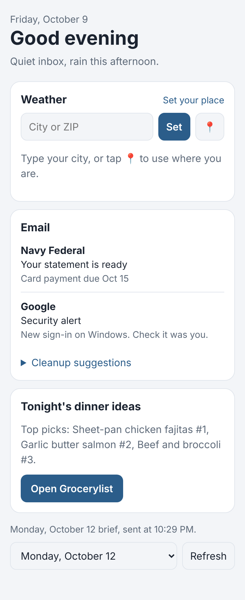

# Daily Brief

Your morning brief as its own app on your phone: what needs you in email,
tonight's top dinner picks, and live weather.
Installs on your home screen like an app and still shows the last brief with no
signal.



Claude's morning run writes the brief at about 7:50am and sends it here. The
weather is fetched live on your phone from [Open-Meteo](https://open-meteo.com)
(free, no key), so it is current whenever you open the app.

## Put it on your phone

It runs free on Cloudflare, in the same account as Grocerylist. From this folder:

```bash
npm install     # one-time, fetches the deploy tool
npm run setup   # signs you in, creates storage, deploys, makes your key
```

At the end it prints:

1. **A link with your key** — open it on your phone, then add it to your home
   screen (iPhone: Share → *Add to Home Screen*; Android: menu → *Install app*).
   If the installed app asks for a key, paste the part after `key=`.
2. **`DAILY_BRIEF_KEY=…`** — add this to your Claude project as an environment
   variable (Project settings → Cloud environment → gear icon) so the morning
   run can send the brief. Don't paste the key into a chat.

After the first time, `npm run deploy` pushes changes.

The key is kept in `.brief-key` in this folder (never committed). To change it,
delete that file and run `npm run setup` again; then update the phone and the
project variable.

## Sending a brief

```bash
curl -fsS -X POST "$DAILY_BRIEF_URL/api/brief" \
  -H "Authorization: Bearer $DAILY_BRIEF_KEY" \
  -H "Content-Type: application/json" \
  --data @brief.json
```

The brief is JSON shaped like [docs/example-brief.json](docs/example-brief.json).
Every field is optional, but there has to be something in it:

| Field | What it is |
|---|---|
| `date` | `YYYY-MM-DD`. Defaults to today in Pacific time. Sending again the same day replaces it. |
| `greeting` | One line under "Good morning". |
| `email.needsYou` | Up to 12 of `{ from, subject, why }`, or plain strings. |
| `email.cleanup` | Junk senders to suggest clearing, `{ sender, count }`. Shown only; the app never touches your mail. |
| `email.note` | Shown when nothing needs you, e.g. "Nothing new". |
| `dinners` | Tonight's picks, best first, as `{ name, url }` (other fields are kept but not shown). The app names the top 3 and links to Grocerylist, where the ideas live. |
| `notes` | Anything else worth a line. |

The last 14 days are kept; the app has a picker for earlier ones.

## Dinner

Dinner ideas, recipes and the shopping list all live in Grocerylist. The brief
names tonight's top picks and has a button that opens Grocerylist's Ideas tab.

## Privacy

A brief summarizes your inbox, so everything under `/api/` needs the key. The
page itself is public but empty without it. Your place for the weather stays on
your phone.

## Working on it

```bash
npm test                                            # no install needed
npx wrangler dev   # run locally
```

For local runs, put `BRIEF_KEY=…` in `.dev.vars`.
